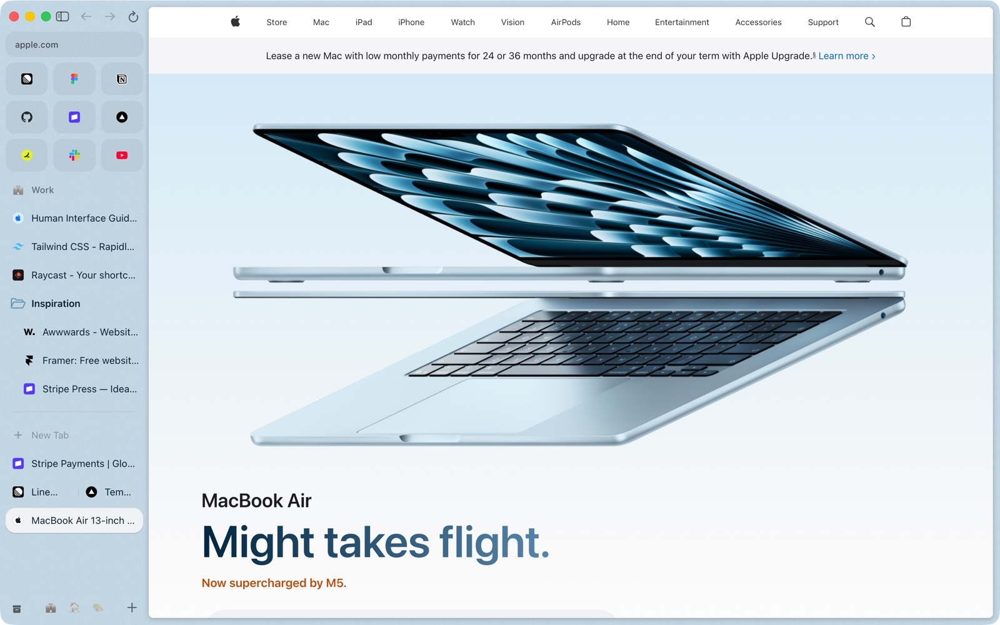
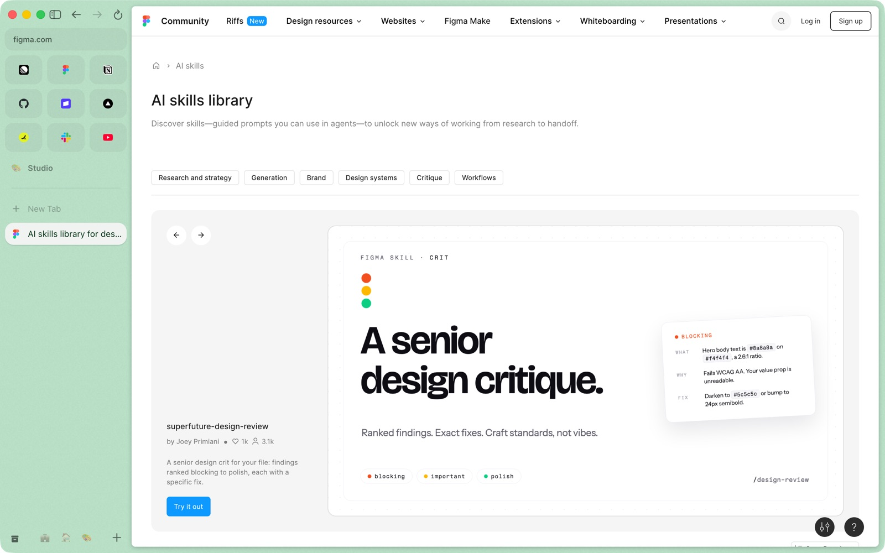
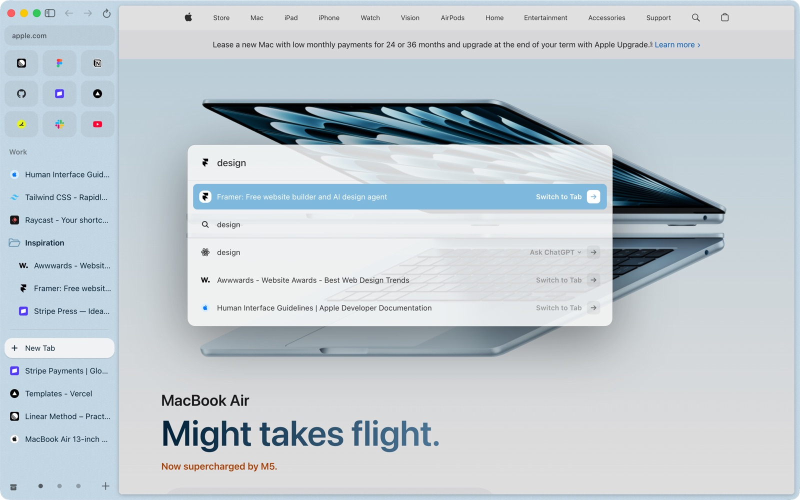
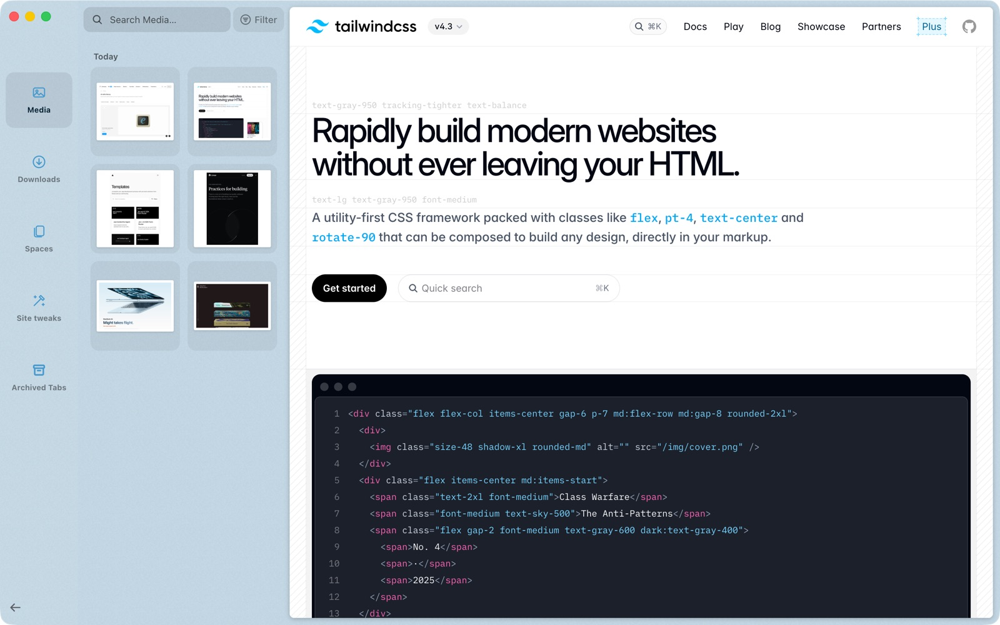
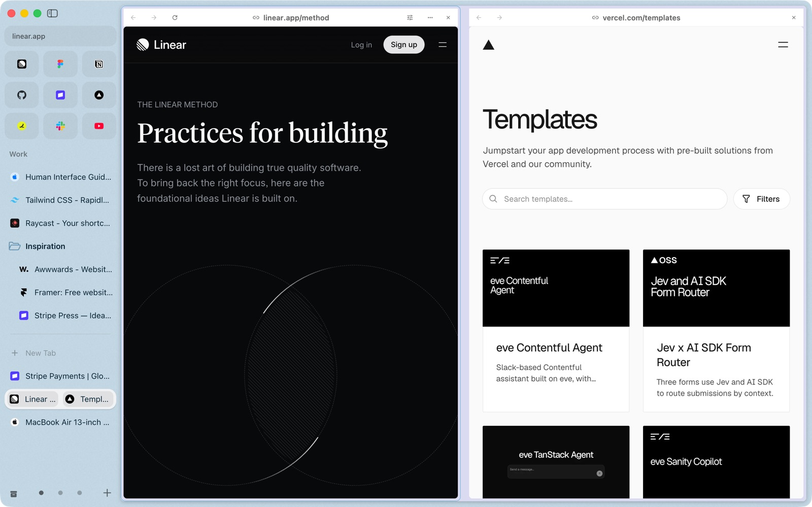
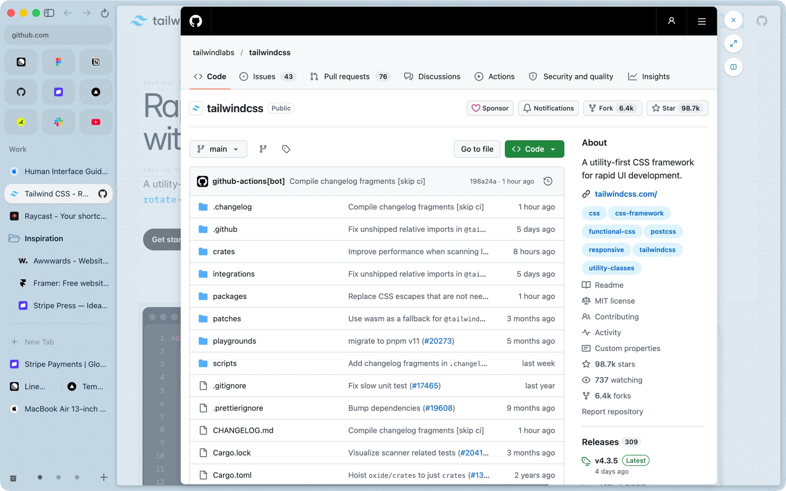
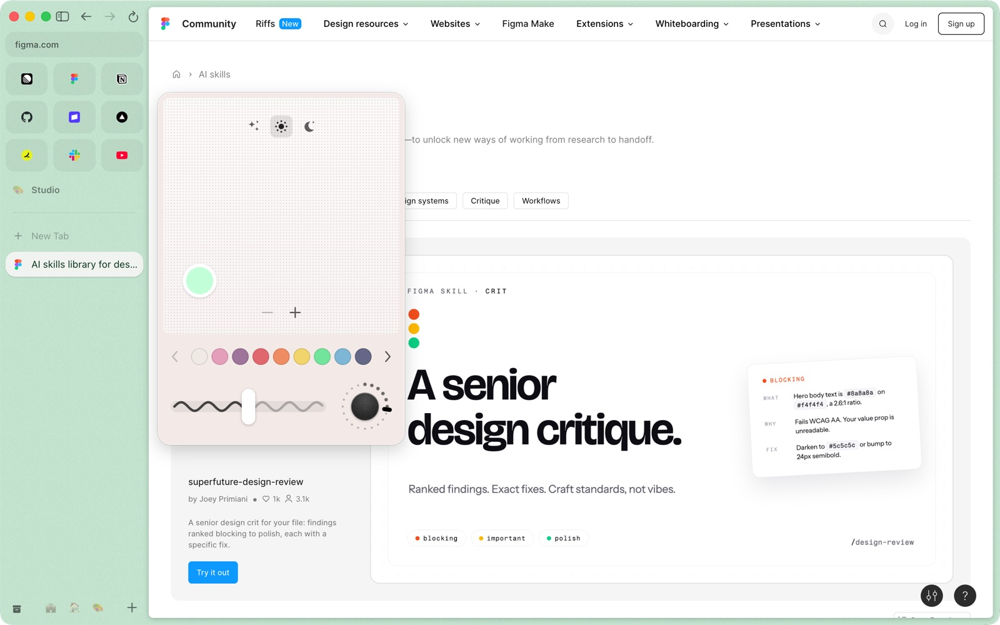
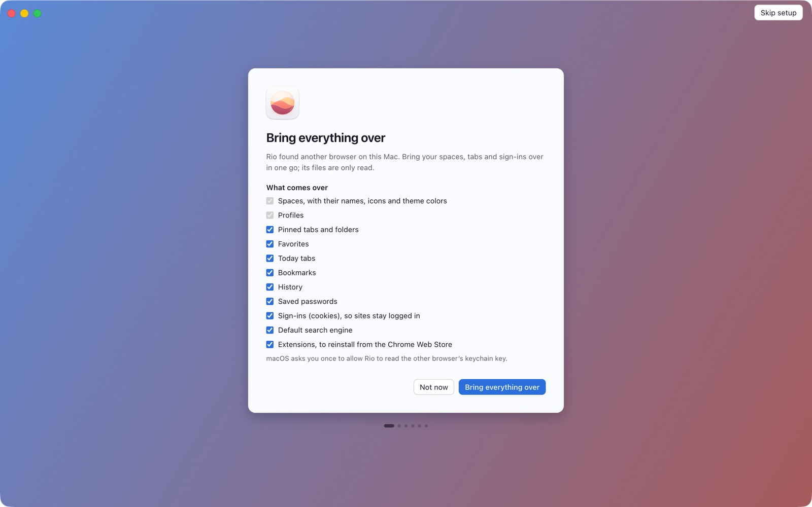

<div align="center">



# Rio

**The open-source Arc alternative for Mac.**<br>
Arc stops working on December 22, 2026. Rio imports your Arc spaces, pinned tabs, folders and favorites in one step, runs Chromium 158, and its Speedometer 3.1 index is above Arc's published one (97.8 vs 91.0).

[](https://github.com/Levivajan/rio-releases/releases/latest/download/Rio.dmg)
[](LICENSE)

[](https://github.com/Levivajan/rio-releases/releases/latest)
[](#requirements)
[](chromium/VERSION)

<picture>
  <source media="(prefers-color-scheme: dark)" srcset=".github/assets/hero-dark.jpg">
  
</picture>

</div>

## Why Rio

Rio puts your tabs in a sidebar and gives each kind of work its own space. If you used Arc, the layout will look familiar, and Rio brings your Arc spaces, pinned tabs, folders and favorites over in one step. It runs on Chromium 158, so your Chrome extensions work, including current MV3 extensions from the Chrome Web Store. Updates arrive through Sparkle from [rio-releases](https://github.com/Levivajan/rio-releases). The source is here under GPL-3.0.

On the same Mac, Rio scored 97.8 on Speedometer 3.1 against Chrome 156.0.8078.81 at 100, and in one run opened 6 sites in 3,880 MB where Chrome used 6,465 MB. The numbers and how we got them are [below](#speed-and-memory).

## What you get

### Spaces, pinned tabs and favorites

Each space has its own pinned tabs, folders and Today tabs, and its own theme color. A pinned tab remembers the page it was pinned on, so you can wander off and come back. Favorites sit in a grid at the top of the sidebar.



### Command bar

Press Cmd+T to search your open tabs, type a URL or ask a question. The screenshot shows the query "design" with tab matches, a search row and an Ask ChatGPT row.



### Library

Downloads, media and screenshots live in one place, so you stop digging through the Downloads folder.



### Split view and Peek

Put two pages side by side, each pane with its own address bar. Open a link in Peek to look at it without leaving the page you are on, then close it, expand it or split it next to your page.





### A color for each space

Pick a theme color per space in the theme editor, so you can tell Work from Studio without reading the tab titles.



## Coming from Arc?

On first run, Rio offers "Bring everything over". The import brings your spaces, pinned tabs, folders and favorites.



Arc is a trademark of The Browser Company of New York. Rio is not affiliated with or endorsed by The Browser Company, Google or Apple. Websites shown in screenshots belong to their owners.

## Speed and memory

**Speedometer 3.1**, as an index with Chrome = 100 (higher is faster):

| Browser | Index | Source |
|---|---:|---|
| Chrome | 100 | baseline |
| **Rio** | **97.8** | Our run against Chrome 156.0.8078.81 on the same Mac, 2026-11-09 |
| Edge | 97.1 | BrowseRating, updated 2026-10-03 |
| Safari | 95.0 | BrowseRating |
| Comet | 95.0 | BrowseRating |
| Brave | 94.3 | BrowseRating |
| Arc | 91.0 | BrowseRating |
| Dia | 89.3 | BrowseRating |
| Firefox | 82.0 | BrowseRating |
| Atlas | 67.4 | BrowseRating |

Rio is 6.8 points above Arc's published index (97.8 against 91.0, about 7% higher) and 2.2 points below Chrome. Each index is a score against Chrome on the machine that ran it, and Arc's comes from a different Mac than ours. We did not run the other browsers ourselves. The BrowseRating figures ([browserating.com](https://browserating.com)) come from their page, which does not publish its hardware, so the rows are not from one machine. Another source puts Safari at 98.1, so we make no claim against Safari.

**Memory**, the same 6 sites open in each browser, measured 2026-11-09 as resident memory of every process, 20 seconds after the sixth site opened:

| Browser | Memory | Processes |
|---|---:|---:|
| Chrome | 6,465 MB | 41 |
| **Rio** | **3,880 MB** | 23 |

That is 2,585 MB less than Chrome (3,880 against 6,465, 40% lower). This is one run with 6 sites. A larger test across 11 browsers is running and will replace this table.

## Requirements

- A Mac with Apple silicon. Intel Macs are not supported.
- macOS 13 (Ventura) or newer.

## Install

1. [Download Rio.dmg](https://github.com/Levivajan/rio-releases/releases/latest/download/Rio.dmg) and drag Rio to Applications.
2. The current build is signed with a self-signed certificate and is not notarized yet, so macOS stops it on first open. Open Rio once and close the warning. Then go to System Settings, Privacy & Security, scroll to Security, click Open Anyway next to Rio, and confirm. On macOS 13 and 14 you can instead right-click Rio in Applications, choose Open, then confirm.
3. Updates are delivered inside the app through Sparkle.

## Open source

Rio is a patch set of 60 files against Chromium 158 plus new code under `chromium/clu`, released under the [GPL-3.0 license](LICENSE). "Clu" is the code name that directories, namespaces and targets keep. Forks are welcome under the GPL: if you distribute one, you release its source under GPL-3.0 too. Whatever you ship, rename it and use your own bundle id, update feed and update key.

To report a bug, open an [issue](https://github.com/Levivajan/rio/issues/new/choose) and fill in the template. For a question or an idea, use [Discussions](https://github.com/Levivajan/rio/discussions). Security problems go through the private form described in [SECURITY.md](SECURITY.md). Code changes are covered in [CONTRIBUTING.md](CONTRIBUTING.md).

## FAQ

**Is Rio Chrome?**
Rio is built on Chromium, the open source project behind Chrome, so pages render the same way and Chrome extensions work. It is a separate browser with its own interface.

**Which Chrome extensions work?**
Extensions from the Chrome Web Store, including current MV3 extensions.

**Does it run on Intel Macs or Windows?**
No. Rio is for Apple silicon Macs on macOS 13 or newer.

**How do I update?**
Rio checks for updates itself through Sparkle, using the feed in [rio-releases](https://github.com/Levivajan/rio-releases).

**Why does macOS warn me on first launch?**
The build is self-signed and not notarized yet. See [Install](#install) for the steps.

**Can I fork it?**
Yes, under GPL-3.0, which means you publish the source of what you distribute. Rename your fork and change the bundle id, update feed and update key.

**Where is "clu" from?**
Clu is the code name. You see it in `chromium/clu`, `chrome://clu-frame` and test target names.

## Build from source

### Work on the UI without building Chromium

You need Node 24 and npm.

```sh
npm install
npm run typecheck
npm run lint
npm run test:unit                 # Vitest: shared logic, scripts, React components
npm run gen:chromium -- --check   # generated mojom, wire table and command table are current
npm run build:webui               # out/webui/{frame,overlay} plus their .grd files
npm run test:webui                # headless Chromium against the fake-bridge harness
npm run verify                    # all of the above in order
```

`npm run ui:fake` serves the WebUIs with an in-memory fake browser on `http://127.0.0.1:4178/`.

### Build the browser

Requirements:

- A Mac with Apple Silicon. The build scripts target arm64 only, and the app itself needs macOS 13 or newer.
- Full Xcode (not only the command line tools) at `/Applications/Xcode.app`, with a macOS SDK 15 or newer. Run `sudo xcode-select -s /Applications/Xcode.app/Contents/Developer` and `sudo xcodebuild -license accept`.
- Node 24 and npm, Python 3, git, and `gh` only if you publish releases.
- Disk: the shallow Chromium checkout is about 31 GB and the hooks add 5 to 10 GB. A dev build needs 40 to 60 GB, a release build 20 to 30 GB more. `build.sh` refuses to start with less than 60 GB free. Plan on about 180 GB.
- RAM: peak 12 to 16 GB while compiling, 15 to 25 GB for the final link of a release build.
- Time (estimates for an M4 Max with 14 cores): a first `dev` build takes 2.5 to 4 hours, a first official `release` build with ThinLTO and PGO 4 to 6 hours. Rebuilding after one `.cc` edit takes 1 to 3 minutes. The build is slow on a laptop and uses most of its cores.

Steps. The Chromium checkout lives outside this repository, default `~/Developer/clu-chromium.noindex`; set `CLU_CHROMIUM_ROOT` to change it. `sync.sh` needs `depot_tools` in that folder first:

```sh
mkdir -p ~/Developer/clu-chromium.noindex && cd ~/Developer/clu-chromium.noindex
git clone https://chromium.googlesource.com/chromium/tools/depot_tools.git
cd -

# For release builds, set checkout_pgo_profiles to True in ~/Developer/clu-chromium.noindex/.gclient after the first sync,
# then run sync.sh again.
scripts/chromium/sync.sh          # shallow gclient sync to chromium/VERSION, then runhooks (needs Xcode)
scripts/chromium/apply.sh --dry-run   # optional: checks every patch against the checkout, writes nothing
scripts/chromium/apply.sh         # patches, branding and chromium/clu into the checkout; a rerun reverts and reapplies
scripts/chromium/build.sh dev     # build:webui, gn gen, autoninja into out/Dev   (also: fast, release)
```

`build.sh` runs `npm run build:webui` itself, so run `npm install` once first. It fetches EasyList and EasyPrivacy for the ad blocker before each build. Add `--away` for an overnight build (higher priority on all cores, keeps the Mac awake). The app lands in `out/<Profile>/Rio.app` inside the checkout.

Notes on what a source build does not have:

- API keys. Safe Browsing on live pages needs a Google API key. Put `google_api_key = "<your key>"` in `~/.clu/keys.gn` and `build.sh` appends it. Without one, the browser builds and runs without that feature.
- Widevine. Builds set `ignore_missing_widevine_signing_cert = true`, so DRM video works only as far as an unsigned host allows.
- Google services. Chrome Sync, Translate and the Chrome Web Store sign-in are not available to forks.
- Updates. `enable_updater = false`; Rio updates itself through Sparkle only in packaged builds that have a feed and an update key.

#### Signing and packaging

`scripts/chromium/sign-dev.sh out/Release/Rio.app` signs the app. With `CLU_SIGN_KEYCHAIN` and `CLU_SIGN_IDENTITY` set it uses a self-signed identity, which is enough to run on your own Mac and keeps Keychain grants across your rebuilds. With no identity it signs ad hoc. Distributing to other Macs needs your own Apple Developer ID and notarization (`CLU_NOTARY_PROFILE`). `scripts/chromium/package.sh` builds `Rio.dmg` and a Sparkle update archive from a built app. Its settings come from the environment or `~/.clu/package.env`; run any script with `--help` or `--dry-run` first. If you ship a fork, use your own bundle id, update feed and Sparkle key.

#### Tests of the browser code

`scripts/chromium/test.sh` builds and runs `clu_unittests` and `clu_browsertests` through the Chromium build. Browser tests open windows, so run them on a Mac you are not using.


## What is in this repository

| Path | What it holds |
|---|---|
| `chromium/` | Chromium-side code: `clu/` (copied to `src/clu` in the checkout), `patches/`, `branding/`, `args/`, `VERSION` |
| `scripts/chromium/` | `sync.sh`, `apply.sh`, `build.sh`, `package.sh`, the mojom generator and the WebUI build |
| `src/renderer` | The React UI, shown as two Chromium WebUIs |
| `src/shared` | The zod contract, the state shape, the command and key table |
| `e2e/chromium-webui` | Playwright specs for the WebUI harness |

## Licensing

Rio is licensed under the GNU General Public License v3.0 only (GPL-3.0-only), see [LICENSE](LICENSE).

Chromium and the third-party components in the app keep their own licenses, see [NOTICE](NOTICE).

Made by [Levon Adamyan](https://www.linkedin.com/in/levon-adamyan), Founder of Rio and [Clu](https://clugtm.com).
